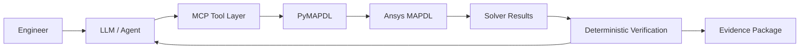

# FEA Engineering Agent

**AI-assisted model interrogation, migration, verification, and review for engineering simulation.**

This repository is the development workspace for an engineering agent that connects a large language model (LLM) to finite-element analysis tools, with an initial focus on **Ansys MAPDL / PyMAPDL**.

The goal is not to make a chatbot that merely writes APDL commands. The goal is to build a system that can:

- interrogate an existing FE model in plain language,
- compare two model revisions semantically,
- identify legacy or unsupported modeling constructs,
- propose modern replacements,
- modify **a copy** of the model,
- rerun the solver,
- verify that engineering behavior is preserved,
- trace every conclusion back to model entities, solver output, and source evidence.

> **Design principle:** the LLM reasons, PyMAPDL executes, MAPDL solves, and deterministic checks verify.

---

## Why this project exists

Real engineering models often outlive the software versions in which they were created. A model may contain old element technologies, undocumented restraints, unusual material definitions, legacy command syntax, or assumptions whose intent is no longer obvious.

A typical migration or review effort can involve hours of manual work just to answer questions such as:

- What elements are connected to this node?
- Where is this material used?
- Which restraints changed between revisions?
- Why did a mode appear or disappear?
- Which model change caused a demand to move?
- Can this old element be replaced without changing the physical behavior?
- Did a solver upgrade preserve mass, stiffness, modal response, reactions, and selected element forces?

This project treats those tasks as an **engineering reasoning + solver verification problem**, not just a file-conversion problem.

---

## Core architecture



### Acronyms

- **API — Application Programming Interface**  
  A structured way for one software system to request data or actions from another.

- **LLM — Large Language Model**  
  Interprets engineering intent, plans tool use, and explains results. It is **not** the numerical solver.

- **MCP — Model Context Protocol**  
  A standardized way for an AI system to discover and call external tools with structured inputs and outputs.

- **PyMAPDL — Python interface to Ansys MAPDL**  
  Provides programmatic control of MAPDL from Python.

- **MAPDL — Mechanical APDL**  
  The finite-element solver that performs the actual numerical analysis.

Official PyMAPDL-MCP project: https://github.com/ansys/pymapdl-mcp

---

## Project roadmap

### 1. Model interrogation

Ask the model questions without remembering APDL syntax.

```text
> What elements are connected to node 574?
> Highlight all elements using material 302.
> Show the restraints at nodes 845 through 848.
> Which components contain PIPE or BEAM elements?
```

Expected output:

- entity lists,
- model selections,
- highlighted plots,
- relevant properties,
- exact commands / tool calls used to obtain the answer.

### 2. Semantic model diff

Compare two FE revisions in engineering terms rather than line-by-line text differences.

```text
> Compare Model A and Model B.
```

Example report:

```text
Boundary conditions
  - 4 support nodes changed from laterally fixed to sliding

Elements
  + 16 beam elements added

Materials
  - no global material changes
  + E modified for 12 selected elements

Mass
  +0.18%

Dynamics
  Mode 1: 5.02 Hz -> 4.31 Hz

Status
  REVIEW REQUIRED: support kinematics changed materially
```

### 3. Root-cause investigation

The agent should be able to test an explanation rather than simply state one.

```text
> Why is the first mode lower in Model B than Model A?
```

Possible workflow:

1. compare mass,
2. compare material stiffness,
3. compare mesh / connectivity,
4. compare boundary conditions,
5. form a hypothesis,
6. run a controlled counterfactual case,
7. quantify how much of the difference is recovered.

The comparison is **simulation-to-simulation** unless measured test data are explicitly provided.

### 4. Legacy-model migration

```text
Legacy MAPDL model
        |
        v
Inventory elements / commands / materials / real constants
        |
        v
Detect unsupported or deprecated constructs
        |
        v
Propose modern replacements
        |
        v
Human review / approval
        |
        v
Modify a COPY
        |
        v
Run modern solver
        |
        v
Behavioral equivalence checks
```

### 5. Behavioral equivalence proof

A migration is not complete because the input file runs. It is complete only when the engineering behavior is shown to be acceptably equivalent.

Planned verification checks include:

| Check | Typical metric |
|---|---|
| Node / element inventory | exact or explained difference |
| Connectivity | graph / component comparison |
| Mass | X / Y / Z totals and distribution |
| Boundary conditions | DOF-by-DOF semantic comparison |
| Static reactions | percent difference |
| Displacements | selected control locations |
| Natural frequencies | mode-by-mode difference |
| Mode shapes | MAC / correlation check |
| Selected element forces | component / end / coordinate basis |
| Result provenance | model + case + result file + extraction definition |

### 6. Continuous verification for FEA

Treat important FE-model changes more like software changes.

```text
git push
   |
   v
GitHub Action
   |
   v
Self-hosted engineering runner
   |
   v
MAPDL solve + regression checks
   |
   v
Pull-request engineering review
```

Example automated PR comment:

```text
FEA REGRESSION REVIEW

PASS  Model parsed successfully
PASS  Total mass change: +0.18%
WARN  Boundary-condition changes: 4 nodes
WARN  Mode 1: 5.02 -> 4.31 Hz
PASS  Modes 2-10: < 3% difference
PASS  Selected static reactions: < 2% difference

ENGINEERING REVIEW REQUIRED
Support kinematics changed at the identified support group.
```

A production implementation would use a **self-hosted runner** with access to the required Ansys installation and license.

### 7. Engineering red-team mode

A future review mode asks a different question:

> **What assumptions are most capable of changing the engineering conclusion?**

Candidate checks may include:

- support stiffness / releases,
- contact stiffness,
- material stiffness,
- damping,
- lumped-mass location,
- mesh density,
- element formulation,
- coordinate-system interpretation.

The output is a ranked sensitivity / robustness review rather than an AI-generated opinion.

### 8. Multimodal model review

Longer-term goal:

```text
Drawing + specification + calculation + FE model + results
                         |
                         v
                 Engineering agent
                         |
                         v
         "Does the model represent the detail?"
```

The agent should link physical intent in drawings or calculations to the actual model entities that implement it.

---

## Public demonstration model

The first public benchmark is planned around the **NRC piping verification problem NUREG/CR-1677, Volume 1, Problem 1**, available through the official PyMAPDL examples.

Why this model is useful:

- it is public,
- it is structurally meaningful,
- it contains straight pipe, elbows, point masses, and fixed anchors,
- it includes modal analysis,
- it includes response-spectrum analysis in three directions,
- it uses GRP modal combination,
- published/reference results are available for regression checks.

Official example:
https://examples.mapdl.docs.pyansys.com/version/dev/verif-manual/vm-nr1677-01-1a.html

The official example reports the first five modal frequencies near:

`28.515, 56.441, 82.947, 144.140, 166.260 Hz`

Those reference values make the model particularly useful for demonstrating automated verification.

See [`examples/nrc_piping/README.md`](examples/nrc_piping/README.md).

> Private client models and proprietary project data are intentionally not included in this repository.

---

## Proposed repository layout

```text
fea-engineering-agent/
|
|-- agent/
|   |-- model_query.py
|   |-- model_diff.py
|   |-- migration.py
|   |-- root_cause.py
|   `-- reviewer.py
|
|-- tools/
|   |-- pymapdl_tools.py
|   |-- extraction.py
|   |-- plotting.py
|   `-- evidence.py
|
|-- verification/
|   |-- mass_check.py
|   |-- bc_check.py
|   |-- modal_check.py
|   |-- reaction_check.py
|   `-- force_check.py
|
|-- examples/
|   `-- nrc_piping/
|
|-- tests/
|
|-- docs/
|   `-- RESEARCH.md
|
|-- .github/workflows/
|   `-- fea-regression.yml
|
`-- README.md
```

---

## Development status

This repository is an active prototype. The project is intentionally being developed in stages so that each new capability can be demonstrated with real solver output rather than only UI mockups.

| Capability | Status |
|---|---|
| Public benchmark selection | Ready |
| PyMAPDL / MCP architecture | Ready for integration |
| Natural-language model interrogation | In development |
| Semantic model diff | Planned |
| Root-cause counterfactual runs | Planned |
| Legacy migration workflow | Planned |
| Deterministic equivalence checks | Planned |
| GitHub continuous verification | Planned |
| Engineering red-team mode | Research / prototype |
| Drawing-to-model multimodal review | Research / prototype |

---

## Research basis

The project is influenced by recent work in agentic simulation, multimodal FEA, verification-first automation, knowledge-graph-assisted scientific agents, and inverse / model-updating methods.

A presentation-oriented literature summary is maintained in:

**[`docs/RESEARCH.md`](docs/RESEARCH.md)**

Highlighted work includes:

- **ALL-FEM** — agentic LLMs for finite-element workflows, *Computer Methods in Applied Mechanics and Engineering*, 2026.
- **AutoFEA** — LLM + graph-based retrieval for FEA input generation, *AAAI*, 2025.
- **OpenFOAMGPT 2.0** — trustworthy end-to-end multi-agent simulation automation, *International Journal of Heat and Fluid Flow*, 2026.
- **FeaGPT** — conversational geometry-mesh-simulation-analysis pipeline, 2025 preprint.
- **VFEAgent** — multimodal, verification-first automated FEA, 2026 preprint.
- **PDE-Agents** — knowledge-graph-augmented multi-agent FEM simulation, 2026 preprint.
- **Differentiable FEM for inverse analysis** — *Computer Methods in Applied Mechanics and Engineering*, 2025.
- **Bayesian FE model updating review** — *Probabilistic Engineering Mechanics*, 2025.

---

## Philosophy

This project follows four rules:

1. **Never ask the LLM to invent a number the solver can calculate.**
2. **Never modify the only copy of an engineering model.**
3. **Every important conclusion should be traceable to evidence.**
4. **Automation supports engineering judgment; it does not replace engineering responsibility.**

---

## Disclaimer

This repository is a research and development prototype for engineering workflow automation. Outputs require qualified engineering review before use in design, qualification, licensing, or safety-related decisions.

Ansys, MAPDL, Mechanical APDL, and PyMAPDL are trademarks or products of Ansys, Inc. This project is not an official Ansys product unless explicitly stated otherwise.
