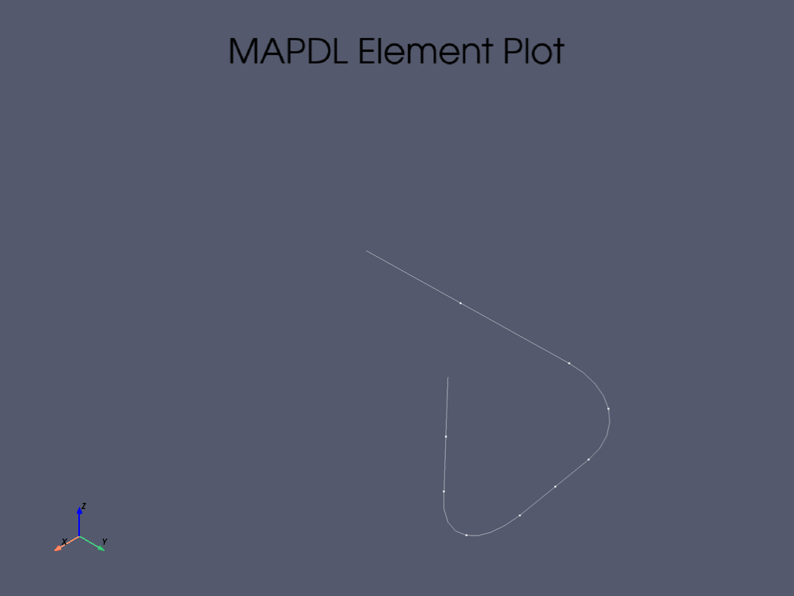

# NRC Piping Demo - Generated Evidence

This report was generated by `run_demo.py` from a live MAPDL session.

## Model

- Nodes: **41**
- Elements: **29**
- Public benchmark: NUREG/CR-1677, Volume 1, Problem 1

## Modal regression check

| Mode | NRC / Ansys reference (Hz) | This run (Hz) | Difference |
|---:|---:|---:|---:|
| 1 | 28.515 | 28.515 | -0.000% |
| 2 | 56.441 | 56.441 | -0.000% |
| 3 | 82.947 | 82.947 | +0.000% |
| 4 | 144.140 | 144.139 | -0.000% |
| 5 | 166.260 | 166.264 | +0.002% |

Maximum absolute frequency difference: **0.002%**

## Model interrogation

### Prompt

> What elements are connected to node 2?

**Solver-derived answer:** 2, 3, 21

Evidence: `NSEL,S,NODE,,2` followed by `ESLN,S`.

### Prompt

> Which elements use material 1?

**Solver-derived element count:** 29

Evidence: `ESEL,S,MAT,,1`.

### Prompt

> Show restraints at node 1.

**Solver-derived answer:** constrained = False

The raw MAPDL `DLIST` rows are preserved in `query_results.json` rather than summarized by an LLM.

## Evidence files

- `01_model_with_bcs.png` - live PyMAPDL model rendering
- `model_summary.json` - model counts and element types
- `modal_check.csv` - reference-vs-computed modal regression
- `query_results.json` - structured solver-derived query evidence
- `query_summary.txt` - compact human-readable query summary

## Why this matters

The first public demo establishes the evidence chain used by later agent capabilities:

`question -> deterministic MAPDL query -> model fact/result -> saved evidence`

The LLM/MCP layer can later call these same tools, but it does not invent the model facts or numerical results.
